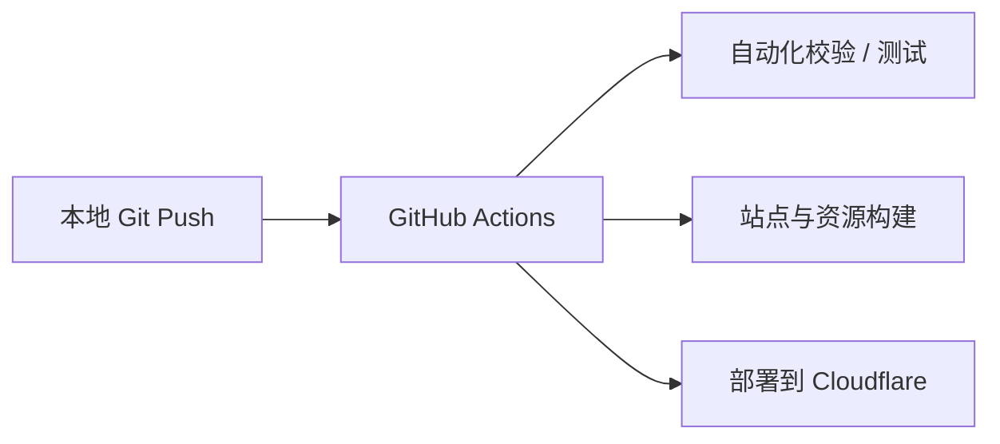

## 自动化流水线流程
所有验证、资源处理与部署都在 GitHub Actions 完成，自动同步到 Cloudflare。


1. **本地推送**：通过git推送 Markdown 内容到 GitHub 仓库。
2. **CI 触发**：GitHub Actions 捕获 `push` 事件并启动构建容器。
3. **自动化处理**：依次执行内容检查、静态资源构建与 SSR 产物打包。
4. **CF部署**：调用 Cloudflare Wrangler，直接更新线上服务。

## GitHub Actions 配置

仓库根目录下创建 `.github/workflows/deploy.yml`：

```yaml
name: Deploy to Cloudflare

on:
  push:
    branches:
      - master
  workflow_dispatch:

jobs:
  deploy:
    runs-on: ubuntu-latest
    steps:
      - name: Checkout repository
        uses: actions/checkout@v4

      - name: Setup Node.js
        uses: actions/setup-node@v4
        with:
          node-version: 22
          cache: 'npm'

      - name: Install dependencies
        run: npm ci

      - name: Run checks
        run: npm test

      - name: Build and deploy
        run: npm run deploy
        env:
          CLOUDFLARE_API_TOKEN: ${{ secrets.CLOUDFLARE_API_TOKEN }}
          CLOUDFLARE_ACCOUNT_ID: ${{ secrets.CLOUDFLARE_ACCOUNT_ID }}
```

### 关键配置说明
在 GitHub 仓库设置中的 `Secrets and variables -> Actions` 添加 `CLOUDFLARE_API_TOKEN` 和 `CLOUDFLARE_ACCOUNT_ID`。

