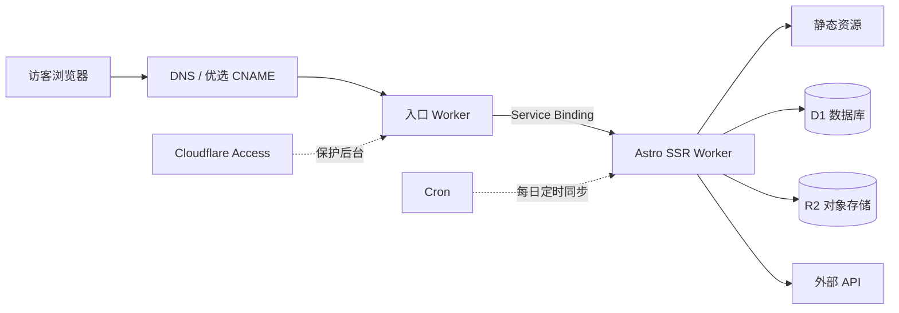
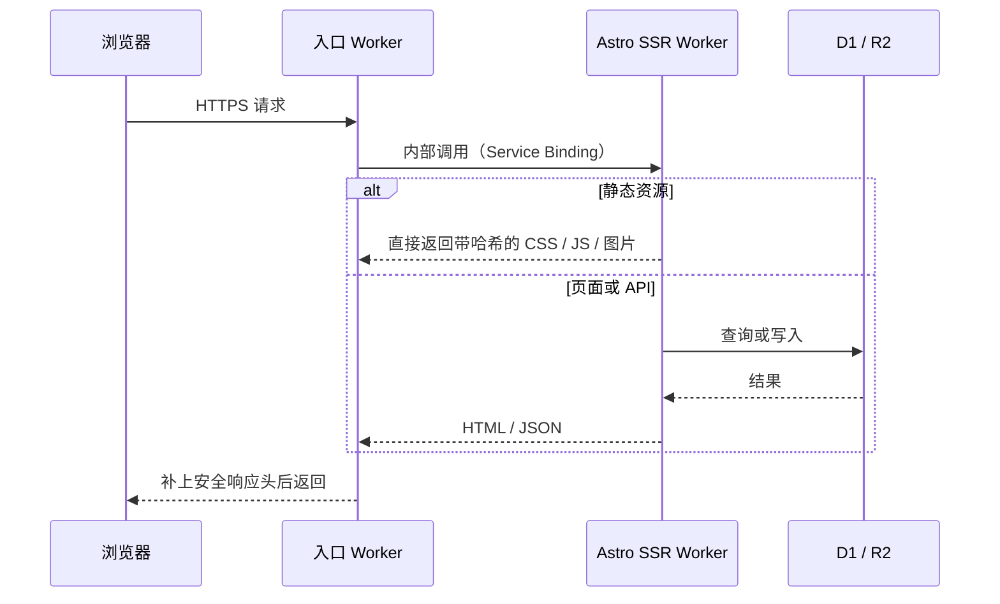

## 引文

我的这个网站跑着两个 Cloudflare Worker、一个 SQL 数据库和一个对象存储。评论、点赞、浏览量是实时的，书影音收藏有自己的管理后台，听歌排行每天凌晨自动同步。而账单里除了域名，其他部分成本约等于零。

这篇文章介绍它的结构

## 单个请求链路

## 数据库设计

D1 是 Cloudflare 的托管 SQLite数据库，用来存结构化数据：评论、点赞、浏览量、书影音收藏的元数据等等。

R2 存所有图片：正文插图、收藏封面。选它的主要原因是出口流量免费，图床最怕的就是流量费。R2 只存文件，而这些文件对应的元数据在 D1 里，两边通过对象键关联。
## 图片Pipeline

我在 Obsidian 里写文章，粘贴图片的瞬间，图床插件把它直接传到 R2，Markdown 里留下的是一个在线 URL。仓库里从头到尾没有图片二进制文件，git 历史不会膨胀。

构建的时候，脚本会为每张首次出现的图生成 AVIF 和 WebP 的多个宽度版本（640 / 1280 / 1920），传回 R2 同目录，并把映射写进 manifest。渲染时 Markdown 里那个 URL 不变，输出的 HTML 却是完整的 `<picture>`：浏览器按视口和像素密度挑最小够用的文件，正文第一张图高优先级加载，其余的懒加载。原图 URL 永远有效，作为兜底。

## 省米小策略

>如果你的站是纯静态博客，Astro 加静态资源托管就够了，一个 Worker 都不需要。
  如果需要评论、后台、定时任务，D1 加 SSR Worker 成本比较低。

### Worker
命中静态资源的请求不执行代码，也不计入 Workers 的每天10万次免费请求额度。CSS、JS、字体、本地图片都属于这类，它们免费且不限量。真正消耗每天 10 万次免费额度的，只有需要跑代码的 HTML 渲染和 API 调用。

所以我让尽可能多的请求停在静态层。只有必须动态处理的路径才配置成先过 Worker。这样请求消耗基本都在免费额度范围内

### D1
留意D1的行读取量。D1 免费额度每天 500 万行，但按的是扫描行数，不是返回行数。一个返回 20 条评论的查询，如果没走索引扫了全表，计的可能是几万行。给常用过滤字段建索引、列表分页，这些优化能最大程度利用D1免费额度。

###  注意免费额度限制
这里的零成本需要加限定：除域名外、访问量和数据量在免费额度内时，账单约等于零。额度具体是（2026 年 7 月）：

| 项目           | 免费额度               |
| ------------ | ------------------ |
| Workers 动态请求 | 10 万次/天，账户共享       |
| 静态资源请求       | 免费，不限量             |
| D1           | 500 万行读/天，10 万行写/天 |
| R2           | 10 GB 存储，出口流量免费    |

注意10 万次是整个账户每天的免费上限，不是每个 Worker 各 10 万
特别注意：D1 按扫描行计数，无索引查询直接账单爆炸

## 中国大陆访问加速

Cloudflare 的默认入口是 Anycast，路由由 BGP 决定，对国内三大运营商不总是友好。同一个站，电信可能很快，移动晚高峰可能绕路丢包。我的做法是优选 CNAME：把域名 CNAME 到一个会持续测速、更新解析结果的目标域名。

进站之后的速度靠缓存分层，规则按内容多久会变来定：
- 带内容哈希的 CSS / JS / 字体：缓存一年
- HTML：`no-cache`，每次要重新验证，保证用的是最新的代码
- 评论、统计这类动态 API：边缘缓存 15 秒，写请求一律 `no-store`。
- GitHub 热力图缓存 6 小时，WakaTime 缓存 15 分钟。

## 省流

## 参考

- [Workers 平台限制](https://developers.cloudflare.com/workers/platform/limits/)
- [静态资源计费规则](https://developers.cloudflare.com/workers/static-assets/billing-and-limitations/)
- [Service Bindings](https://developers.cloudflare.com/workers/runtime-apis/bindings/service-bindings/)
- [D1 定价](https://developers.cloudflare.com/d1/platform/pricing/)
- [R2 定价](https://developers.cloudflare.com/r2/pricing/)
- [MDN：Cache-Control](https://developer.mozilla.org/docs/Web/HTTP/Reference/Headers/Cache-Control)
