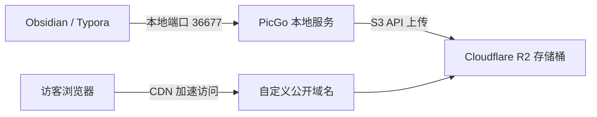

## 方案架构

使用 Cloudflare R2 替代传统对象存储作为图床后端。

1. 编辑器粘贴图片触发本地 PicGo 上传。
2. PicGo 通过 S3 兼容 API 将图片推送至 R2。
3. 接口返回自定义域名链接并自动替换正文文本。

---

## 为什么选择 Cloudflare R2

传统云厂商（AWS S3、腾讯云 COS、阿里云 OSS）的图床最大风险是**下行出口流量计费**。一旦图片被恶意盗刷，会产生高额账单。

Cloudflare R2 核心优势在于**彻底免除出口流量费用**。

### 免费额度对比

| 资源项目 | Cloudflare R2 免费月额度 | 超额计费单价 |
| :--- | :--- | :--- |
| **存储空间** | 10 GB / 月 | $0.015 / GB / 月 |
| **Class A 操作（写入/列出）** | 100 万次 / 月 | $4.50 / 百万次 |
| **Class B 操作（读取/下载）** | 1000 万次 / 月 | $0.36 / 百万次 |
| **出口流量（Egress）** | **永久免费，无上限** | **$0.00** |

个人博客插图每月通常在几千次访问内，完全落在免费配额区间内。

---

## Cloudflare R2 开通与准备

### 1. 开通 R2 服务
1. 登录 Cloudflare 控制台，进入「R2 对象存储」。
2. 绑定信用卡或 PayPal 完成账户验证。额度内不会产生扣费。

### 2. 创建存储桶（Bucket）
1. 在 R2 页面点击「创建存储桶」。
2. 输入存储桶名称（例如 `bed`）。
3. 位置建议选择「自动」或就近区域，点击完成创建。

### 3. 绑定公开自定义域名
R2 默认存储桶未开放公网访问，需要绑定域名：
1. 进入刚创建的存储桶，选择「设置」选项卡。
2. 定位到「公开访问」区域，点击「连接域」。
3. 输入二级域名（例如 `img.yourdomain.com`）。
4. 确认后 Cloudflare 会自动配置 DNS CNAME 解析并签发 SSL 证书。

### 4. 获取 API 凭证
PicGo 需要使用 S3 协议凭证连接 R2：
1. 回到 R2 主界面，点击右侧「管理 R2 API 令牌」。
2. 点击「创建 API 令牌」。
3. 权限选择「对象读和写」。
4. 指定存储桶选择刚才创建的桶，或者允许全部存储桶。
5. 复制并妥善保存以下四个参数（机密访问密钥仅展示一次）：
   - **Account ID**（控制台或 URL 中的账户 ID）
   - **Access Key ID**（访问密钥 ID）
   - **Secret Access Key**（机密访问密钥）
   - **Endpoint**（形如 `https://<ACCOUNT_ID>.r2.cloudflarestorage.com`）

---

## PicGo 客户端配置

### 1. 安装插件
PicGo 推荐安装 `s3` 插件支持 R2 上传：
1. 打开 PicGo 界面，进入「插件设置」。
2. 搜索 `s3` 并安装 `picgo-plugin-s3`（亦可搜索安装 `picgo-plugin-cloudflare-r2`）。
3. 安装完毕后重启 PicGo。

### 2. 参数配置对照表
进入「图床设置」->「Amazon S3」，填写以下核心参数：

| 配置项 | 填写内容 | 说明 |
| :--- | :--- | :--- |
| **应用密钥 ID** | R2 生成的 `Access Key ID` | 身份凭证 |
| **应用密钥** | R2 生成的 `Secret Access Key` | 密码凭证 |
| **桶名** | 创建的 R2 存储桶名（例如 `bed`） | 目标 Bucket |
| **文件路径** | `{year}/{month}/{md5}.{extName}` | 自定义命名规则 |
| **自定义节点** | `https://<ACCOUNT_ID>.r2.cloudflarestorage.com` | R2 S3 终结点地址 |
| **自定义域名** | `https://img.yourdomain.com` | 前面绑定的公开二级域名，末尾不加斜杠 |
| **区域（Region）** | `auto` | 填 `auto` 或 `us-east-1` |

配置完成后点击「确定」并「设为默认图床」。上传一张测试图，确认返回链接可正常公网访问。

---

## 编辑器自动无感上传

### Obsidian 配置
利用本地 PicGo Server 实现写笔记时粘贴即自动上传：
1. 确保 PicGo 处于运行状态，并在 PicGo 设置中开启「PicGo Server」（默认监听 `127.0.0.1:36677`）。
2. 在 Obsidian 的「第三方插件」中搜索并安装 `Image auto upload Plugin`。
3. 开启插件，接口地址保持默认 `http://127.0.0.1:36677/upload`。
4. 在 Obsidian 中直接粘贴或拖入图片，图片将在后台静默上传至 R2，正文中的本地路径自动替换为远程图床链接。

### Typora 配置
Typora 原生支持调用 PicGo 客户端：
1. 打开 Typora，进入「偏好设置」->「图像」。
2. 插入图片时选择「上传图片」。
3. 勾选「对本地位置的图片应用上述规则」与「对网络位置的图片应用上述规则」。
4. 上传服务选择 `PicGo (app)`，在「PicGo 路径」中指定本地 PicGo 可执行文件。
5. 点击「验证图片上传选项」，全部验证通过即配置成功。

---

## 进阶：缓存优化与防刷策略

虽然 R2 出口流量免费，但 Class B 读取请求超过 1000 万次/月仍会产生少量计费。建议开启 CDN 边缘缓存与防护。

### 1. 配置 CDN 边缘缓存（Cache Rules）
在 Cloudflare 仪表盘中，进入域名的「缓存」->「Cache Rules」，添加规则：
- **匹配条件**：`主机名 等于 img.yourdomain.com`
- **边缘缓存 TTL**：替换源服务器并设为 1 年（31536000 秒）
- **浏览器缓存 TTL**：设为 1 年

所有热点图片将被 Cloudflare 全球 CDN 节点缓存，后续请求不再穿透到 R2 存储桶，Class B 操作消耗降至最低。

### 2. 基础防盗链（WAF 规则）
在域名的「安全性」->「WAF」中新建自定义规则，防止其他网站直接盗用图片资源：
- **表达式**：`http.host eq "img.yourdomain.com" and not http.referer contains "yourdomain.com" and not http.referer eq ""`
- **操作**：阻止（Block）或托管质询（Managed Challenge）
