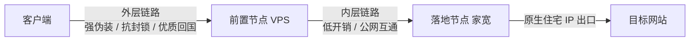

## 链路拓扑

链式代理的核心逻辑是职责解耦。前置节点负责抗审查，落地节点负责伪装住宅身份。
- **前置节点，对干不干净没有要求，延迟低、协议正确即可
- **落地节点，负责业务身份认证。提供纯净的原生住宅 IP

---
## 前置节点常见协议对比

前置链路运行在公网审查环境中，协议必须兼顾抗封锁能力、握手延迟与传输性能。

| 协议 / 组合              | 传输层载体      | 核心机制与特征                              | 伪装与抗阻断能力                             | 弱网与延迟表现                      | 资源开销                       |
| :------------------- | :--------- | :----------------------------------- | :----------------------------------- | :--------------------------- | :------------------------- |
| **VLESS-Reality**    | TCP        | 借用外部真实网站证书与 SNI，服务端通过私钥认证客户端         | 极高。消除服务端证书指纹，TLS 握手与真实目标完全一致         | 标准 1-RTT 握手，弱网丢包易引发 TCP 队头阻塞 | 极低。无复杂加解密，直接解耦传输           |
| **Hysteria 2**       | UDP (QUIC) | 魔改 QUIC 协议，内置双向端口跳跃与自研 Brutal 激进拥塞控制 | 高。伪装为标准 HTTP/3 流量或纯随机混淆载荷            | 极低。0-RTT 快速重连，抗丢包率可达 30% 以上  | 中高。用户态 UDP 收发与发包计算占用 CPU   |
| **TUIC v5**          | UDP (QUIC) | 基于标准 QUIC 协议，支持原生多路复用与 BBR 拥塞控制      | 较高。流量表现为标准 QUIC 数据流                  | 极低。握手速度快，无队头阻塞               | 中等。相较 Hysteria 2 拥塞控制更保守规范 |
| **Shadowsocks 2022** | TCP / UDP  | 对称加密分组密码，固定长度头部，支持重放攻击防护             | 中等。表现为无特征高熵密文，易被启发式探测针对              | 极低。单次握手直接收发，协议内开销极小          | 极低。完全支持硬件 AES-NI 加速        |
| **Trojan**           | TCP        | 密码哈希嵌入 TLS 载荷，验证失败转发至真实 Web 站点       | 高。依赖真实域名证书，协议特征接近正常 HTTPS            | 标准 1-RTT 握手，依赖底层 TCP 栈性能     | 低。直接交由系统标准 TLS 库处理         |
| **VMess + WS + TLS** | TCP        | 协议指令封装在 WebSocket 帧内，外层包裹标准 TLS 隧道   | 极高。支持接入 Cloudflare 等 CDN 反向代理隐藏真实 IP | 差。多层状态机导致 RTT 累加，延迟与抖动较大     | 高。数据包需要多轮封装与解构             |

---

## 如何选择链式代理前置节点

选择前置节点时，需要兼顾几何路由、互联带宽与协议协同。

### 1. 规避三角路由延迟
端到端总延迟公式为：

$$\text{RTT}_{\text{Total}} = \text{RTT}_{\text{Client} \to \text{Transit}} + \text{RTT}_{\text{Transit} \to \text{Egress}} + T_{\text{Processing}}$$

前置节点应位于客户端与落地的地理中间线或骨干枢纽。
- **推荐拓扑**：国内客户端 $\to$ 广港/沪日/美西优质机房（前置） $\to$ 美西家宽（落地）。链路同向延伸，总延迟仅增加 $10 \sim 30\text{ ms}$。
- **错误拓扑**：国内客户端 $\to$ 欧洲机房（前置） $\to$ 美西家宽（落地）。跨洋折返跑导致物理延迟增加 $200\text{ ms}$ 以上。

### 2. 前置到落地的互联带宽
前置 VPS 到落地家宽属于海外公网互联。优先选择接入一级运营商骨干网（如 Telia、Lumen、Cogent、NTT）的机房。同城或同地区互联更佳，延迟通常小于 $15\text{ ms}$ 且丢包率接近零。

### 3. 避免双重加密嵌套
双重加密会导致性能严重损耗。
- 外层链路（客户端 $\to$ 前置）：采用 VLESS-Reality 或 Hysteria 2 处理抗审查与抗丢包。
- 内层链路（前置 $\to$ 落地）：采用轻量协议（如 Shadowsocks 2022、WireGuard 或 SOCKS5 over SSH）。
- **禁忌**：禁止外层 TLS 套内层 TLS。双重握手成倍增加 RTT，降低吞吐量并浪费 CPU 算力。

### 4. 完整支持 UDP 转发
落地家宽若承载游戏加速、语音通话（Discord）或 QUIC 流量，前置节点必须完整支持 UDP 转发与 Full-Cone NAT。避免使用纯 HTTP 代理隧道。

### 5. 调整 MTU 避免数据包分片
链式代理每叠加一层协议头，有效数据载荷空间就会减少。双层封装容易超出物理网卡的 $1500\text{ 字节}$ MTU 门限，触发 IP 数据包分片。建议将客户端 TUN 虚拟网卡 MTU 主动下调至 $1350 \sim 1400\text{ 字节}$，消除分片丢包。

---

## 附录：OSI 七层模型在代理技术中的映射

代理与穿透技术贯穿 OSI 模型各层，不同层级对应不同的转发策略与开销。

| 层级 | 英文名称 | 核心功能 | 典型协议 / 数据单元 | 在代理与穿透中的技术实现 |
| :---: | :--- | :--- | :--- | :--- |
| **7** | 应用层 (Application Layer) | 为应用程序提供网络服务接口 | HTTP, HTTPS, DNS, gRPC / 报文 (Message) | HTTP 代理、DNS-over-HTTPS (DoH)、Nginx 反代、CDN 节点转发 |
| **6** | 表示层 (Presentation Layer) | 数据格式转化、加解密与压缩 | TLS, SSL, ASN.1 / 格式化数据 | TLS 握手解密、VLESS Reality 伪装匹配、AEAD 密文解析 |
| **5** | 会话层 (Session Layer) | 建立、管理和终止应用程序会话 | SOCKS5, RPC, SSH / 会话控制 | SOCKS5 握手认证、SSH 动态端口转发隧道维护 |
| **4** | 传输层 (Transport Layer) | 提供端到端的进程通信与流量控制 | TCP, UDP, QUIC / 数据段 (Segment) | iptables / NFTables 端口转发、TPROXY 透明代理、Shadowsocks 转发 |
| **3** | 网络层 (Network Layer) | 逻辑寻址、路由选择与分片控制 | IP (IPv4/IPv6), ICMP / 数据包 (Packet) | TUN 虚拟网卡接管全局 IP、WireGuard、路由表分流规则 |
| **2** | 数据链路层 (Data Link Layer) | 物理寻址、介质访问与帧传输 | Ethernet, Wi-Fi, MAC / 数据帧 (Frame) | TAP 虚拟网卡（桥接二层以太网帧）、VLAN 隔离通道 |
| **1** | 物理层 (Physical Layer) | 通过物理介质传输原始比特流 | 光纤, 双绞线, 射频 / 比特 (Bit) | 物理光缆、海底通信光纤、专线物理链路（不对数据做逻辑处理） |
