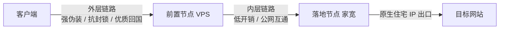

## 链路拓扑

链式代理的核心逻辑是职责解耦。前置节点负责抗审查，落地节点负责伪装住宅身份。
- **前置节点**：对 IP 纯净度无要求，延迟低、协议正确即可。
- **落地节点**：负责业务身份认证，提供纯净的原生住宅 IP。

---
## 前置节点常见协议对比

前置链路运行在公网审查与内网监控环境中，核心关注加密强度与防审计能力。

| 协议 / 类型               | 传输层        | 加密情况                               | 伪装与抗阻断能力                     |
| :-------------------- | :--------- | :--------------------------------- | :--------------------------- |
| **HTTP Proxy**        | TCP        | **无加密**                            | 无伪装。纯明文文本，网关直接正则匹配           |
| **SOCKS5**            | TCP / UDP  | **无加密**                            | 无伪装。固定十六进制握手特征 (`05 01 00`)  |
| **Shadowsocks**       | TCP / UDP  | **对称强加密** (AES-256-GCM / ChaCha20) | 纯随机密文。无协议明文字段，但易被特征库匹配       |
| **VLESS-Reality**     | TCP        | **TLS 1.3 强加密**（公钥认证）              | 极高。借用外部真实网站 SNI，消除证书特征       |
| **Trojan**            | TCP        | **标准 TLS 1.3 加密**（CA 证书）           | 高。密码塞入 TLS 正文，表现与合法 HTTPS 一致 |
| **Hysteria 2 / TUIC** | UDP (QUIC) | **TLS 1.3 强加密**                    | 伪装为 HTTP/3 流量或随机 UDP 数据      |
> 注意，HTTP 代理不包含传输层加密。中间网络设备直接抓包读取请求头、完整 URL 路径、Cookie 与账号凭证

## 如何选择链式代理前置节点

在小火箭（Shadowrocket）或 Clash 中配置「前置节点 + 美国家宽（落地）」链式代理时，核心逻辑是：**前置节点只充当一条纯粹且透明的 TCP 传输隧道**。

许多协议作为直连节点体验良好，但作为前置节点时会导致严重断流或卡死。

### 1. 为什么高级协议做前置极易断流？

1. **UDP / QUIC 协议无法稳定嵌套（直接断流）**
   - **涉及协议**：Hysteria 1/2、TUIC、WireGuard。
   - **根本原因**：客户端通过 UDP 隧道嵌套 TCP 家宽握手，底层状态机处理繁琐。双层拥塞控制（BBR 与 TCP 拥塞控制）相互竞争冲突，导致连接频繁重置。
2. **Reality / Vision 流控与内层握手冲突（握手失败）**
   - **涉及协议**：VLESS-Reality、VLESS-XTLS-Vision。
   - **根本原因**：Reality 模拟真实网站的 TLS 握手。隧道内部嵌套二次代理握手（如 SOCKS5 或二次 TLS）会污染流量特征，触发 Vision 流控过滤阻断，直接向客户端返回 RST。
3. **gRPC / 多路复用在长延迟下死锁（转圈超时）**
   - **涉及协议**：VMess-gRPC、VLESS-gRPC、开启 Mux 的节点。
   - **根本原因**：动态家宽落地需要 1 到 3 秒时间调度分配住宅 IP。多路复用帧在长延迟叠加下极易触发超时死锁，表现为连接长时间无响应。
4. **WebSocket + CDN 超时掐断（502 / 504 错误）**
   - **涉及协议**：套用 Cloudflare CDN 的 WS 或 gRPC 节点。
   - **根本原因**：CDN 边缘节点有严苛的回源连接超时限制。前置连接慢速家宽网关超时，CDN 直接返回 502 或 504 Gateway Timeout。
5. **家宽不支持 UDP 引发 DNS 解析死锁（全局瘫痪）**
   - **根本原因**：绝大多数商业住宅代理（Bright Data、IPRoyal 等）出于防滥用安全策略，出口网关仅支持纯 TCP，静默丢弃 UDP。
   - 客户端若向家宽发送 UDP DNS 查询，报文全被丢弃。所有域名解析陷入 15 到 30 秒的超时等待，造成全局断网假死。

### 2. 前置协议选型红黑榜

| 评级 | 协议类型 | 技术特性 | 适用评价 |
| :---: | :--- | :--- | :--- |
| **最优选** | **Shadowsocks (SS)** | 纯粹的 TCP 密文字节流，无证书握手与多路复用干扰 | 小火箭与各类客户端链式代理支持最成熟，转发兼容性最好 |
| **推荐** | **Trojan (原生 TCP)** | 单层标准 TLS 加密隧道，握手干净标准 | 无多路复用状态机冲突，适合持有域名的前置机房 |
| **推荐** | **VMess (纯 TCP)** | 基础对称加密传输（禁用 WS，禁用 CDN） | 兼容性良好，适合常规纯 TCP 隧道中转 |
| **避坑** | **Hysteria / TUIC** | 基于 UDP / QUIC 协议栈 | 隧道内嵌套 TCP 家宽连接极易断流失步 |
| **避坑** | **VLESS-Reality** | XTLS-Vision 流控检查与证书偷取机制 | 内层嵌套代理握手导致特征污染，频繁触发连接重置 |
| **避坑** | **任何套 CDN 的节点** | 经过 Cloudflare 等边缘反代 | 叠加家宽分配住宅 IP 延迟，必然触发 CDN 502/504 超时 |

### 3. 认知澄清：Shadowsocks 到底有没有加密？

很多用户常误以为 Shadowsocks 没有加密，这源于两个常见混淆：

1. **混淆了 SOCKS5 与 Shadowsocks**：
   - **SOCKS5**：标准通用协议（RFC 1928），**完全无加密（明文裸奔）**。家宽服务商交付的住宅节点多为此类型。
   - **Shadowsocks (SS)**：专门为抗封锁设计的**强加密代理协议**。强制使用 AEAD 算法（如 `chacha20-ietf-poly1305`、`aes-128-gcm`、`2022-blake3-aes-128-gcm`），传输的全是不可逆高熵密文。
2. **误将“无 TLS 证书”当成“没有加密”**：
   - Trojan 与 VLESS 依赖 TLS 证书伪装成普通 HTTPS 网站。
   - Shadowsocks 不依赖证书，而是采用预共享密钥（PSK）对称加密。外部网络仅能观测到随机二进制流，完全具备防窃听与防篡改能力。
   - 相比 TLS 握手，Shadowsocks 协议开销更小，穿透透传性能最优。

### 4. 客户端配置关键防坑指南

在小火箭等客户端配置链式代理时，必须完成以下三项设置：

1. **关闭落地节点的 UDP 转发（UDP Relay）**：在落地家宽配置中明确禁用 UDP Relay，避免客户端向不支持 UDP 的住宅网关发送数据。
2. **DNS 配置为 Fake-IP 或由前置解析**：将 DNS 解析模式改为 Fake-IP 或指定前置代解，禁止将 UDP DNS 查询丢给家宽落地。
3. **前置节点优选低丢包直连骨干**：家宽本身具备 200ms 以上延迟与动态调度开销，前置 VPS 必须选用电信 CN2 GIA、联通 9929 或移动 CMIN2 等低丢包优质线路。

---

## 附录：OSI 七层模型在代理技术中的映射

代理与穿透技术贯穿 OSI 模型各层，不同层级对应不同的转发策略与开销。

|  层级   | 英文名称  | 核心功能            | 典型协议 / 数据单元                 | 代理中应用                                               |
| :---: | :---- | :-------------- | :-------------------------- | :-------------------------------------------------- |
| **7** | 应用层   | 为应用程序提供网络服务接口   | HTTP, HTTPS, DNS, gRPC / 报文 | HTTP 代理、DNS-over-HTTPS (DoH)、Nginx 反代、CDN 节点转发      |
| **6** | 表示层   | 数据格式转化、加解密与压缩   | TLS, SSL, ASN.1 / 格式化数据     | TLS 握手解密、VLESS Reality 伪装匹配、AEAD 密文解析               |
| **5** | 会话层   | 建立、管理和终止应用程序会话  | SOCKS5, RPC, SSH / 会话控制     | SOCKS5 握手认证、SSH 动态端口转发隧道维护                          |
| **4** | 传输层   | 提供端到端的进程通信与流量控制 | TCP, UDP, QUIC / 数据段        | iptables / NFTables 端口转发、TPROXY 透明代理、Shadowsocks 转发 |
| **3** | 网络层   | 逻辑寻址、路由选择与分片控制  | IP (IPv4/IPv6), ICMP / 数据包  | TUN 虚拟网卡接管全局 IP、WireGuard、路由表分流规则                   |
| **2** | 数据链路层 | 物理寻址、介质访问与帧传输   | Ethernet, Wi-Fi, MAC / 数据帧  | TAP 虚拟网卡（桥接二层以太网帧）、VLAN 隔离通道                        |
| **1** | 物理层   | 通过物理介质传输原始比特流   | 光纤, 双绞线, 射频 / Bit           | 物理光缆、海底通信光纤、专线物理链路                                  |
