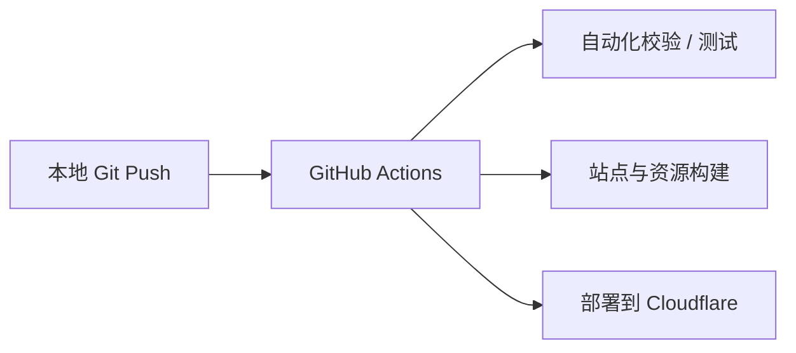

---
title: Automate Blog Updates with GitHub Actions
createdAt: 2026-08-13T00:00:00.000Z
published: true
updatedAt: 2026-08-13T00:00:00.000Z
description: Have GitHub Actions handle the blog’s checks, build, and Cloudflare deployment through an automated pipeline.
tags:
  - Automation
  - Actions
  - Cloudflare
slug: 20260813-01
---

## Automated Pipeline Workflow
All checks, asset processing, and deployment are handled by GitHub Actions and automatically synced to Cloudflare.


1. **Push from Localelujara**: Push Markdown content to the GitHub repository via Git.
2. **CI Trigger**: GitHub Actions capture`push`Trigger the event and start the build container.
3. **Automated Processing**: Run the content checks, build static assets, and package the SSR output in sequence.
4. **Cloudflare Deployment**: Invoke Cloudflare Wrangler to update the live service directly.

## GitHub Actions Configuration

Create it in the repository’s root directory.`.github/workflows/deploy.yml`:

```yaml
name: Deploy to Cloudflare

on:
  push:
    branches:
      - master
  workflow_dispatch:

jobs:
  deploy:
    runs-on: ubuntu-latest
    steps:
      - name: Checkout repository
        uses: actions/checkout@v4

      - name: Setup Node.js
        uses: actions/setup-node@v4
        with:
          node-version: 22
          cache: 'npm'

      - name: Install dependencies
        run: npm ci

      - name: Run checks
        run: npm test

      - name: Build and deploy
        run: npm run deploy
        env:
          CLOUDFLARE_API_TOKEN: ${{ secrets.CLOUDFLARE_API_TOKEN }}
          CLOUDFLARE_ACCOUNT_ID: ${{ secrets.CLOUDFLARE_ACCOUNT_ID }}
```

### Key Configuration Details
In your GitHub repository settings, under`Secrets and variables -> Actions`Add`CLOUDFLARE_API_TOKEN`and`CLOUDFLARE_ACCOUNT_ID`.