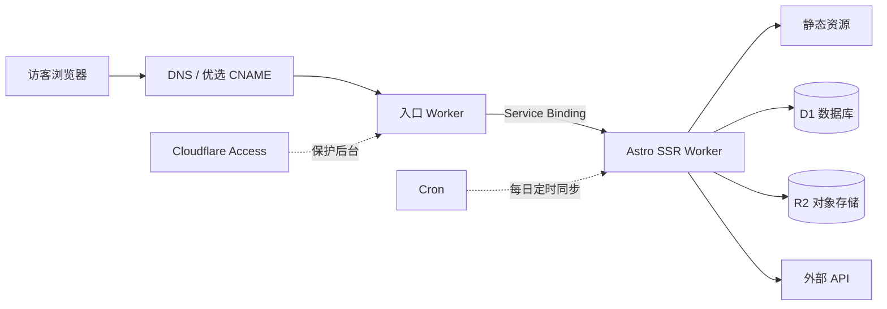
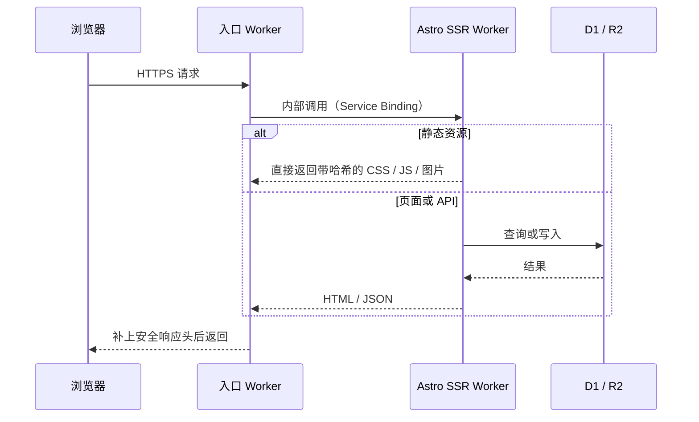

---
title: Building a Personal Website with Cloudflare
description: "Site architecture: two Workers, one SQL database, and one object store"
createdAt: 2026-08-13T00:00:00.000Z
updatedAt: 2026-08-13T00:00:00.000Z
published: true
tags:
  - Network
  - Build a Website
  - Optimization
slug: 20260813-02
---

## Quote

My website runs on two Cloudflare Workers, a SQL database, and an object store. Comments, likes, and view counts update in real time; my book, music, and movie collections have their own admin dashboard; and my music rankings sync automatically every night. Aside from the domain, the rest costs practically nothing.

This article introduces its architecture.

## A Single Request's Path

## Database Design

D1 is Cloudflare’s managed SQLite database, used to store structured data such as comments, likes, view counts, and metadata for books, music, and films in your collection.

R2 stores all images: illustrations in articles and collection covers. The main reason I chose it is that egress traffic is free—bandwidth charges are the bane of image hosting. R2 stores only the files; the metadata for those files lives in D1, and the two are linked by object key.
## Image Pipeline

I write articles in Obsidian. The moment I paste an image, the image-hosting plugin uploads it directly to R2, leaving a URL in the Markdown. There are no image binary files anywhere in the repository, so the Git history never bloats.

At build time, the script generates multiple AVIF and WebP variants at several widths for each image the first time it appears (640 / 1280 / 1920), uploads them to the same directory in R2, and records the mapping in a manifest. When rendered, the URL in the Markdown remains unchanged, but the resulting HTML contains a complete `<picture>` element: the browser selects the smallest file sufficient for the viewport and pixel density, the first image in the article loads at high priority, and the rest are lazy-loaded. The original image URL always remains valid as a fallback.

## A Little Money-Saving Strategy

>If your site is a purely static blog, Astro with static asset hosting is all you need—you don’t need a Worker at all.

If you need comments, an admin panel, or scheduled tasks, D1 with an SSR Worker is relatively inexpensive.

### Worker
Requests for static assets do not execute any code and do not count toward Workers’ 100,000 free requests per day. CSS, JavaScript, fonts, and locally hosted images all fall into this category—they’re free and unlimited. The only things that actually use up the 100,000 free requests per day are HTML rendering and API calls that require code to run.

So I have as many requests as possible handled at the static layer. Only paths that require dynamic processing are configured to pass through a Worker first. This keeps request usage largely within the free tier.

### D1
Keep an eye on D1’s row reads. The free tier allows 5 million rows per day, but it counts rows scanned, not rows returned. A query that returns 20 comments could count tens of thousands of rows if it scans the entire table instead of using an index. Adding indexes to commonly filtered fields and paginating lists can help you make the most of D1’s free tier.

###  A Note on Free-Tier Limits
The “zero cost” claim here needs a qualification: excluding the domain, the bill is approximately zero as long as traffic and data usage remain within the free tiers. The specific limits are as follows (July 2026):

| Item           | Free allowance               |
| ------------ | ------------------ |
| Dynamic Worker requests | 100,000/day, shared across the account       |
| Static asset requests       | Free, unlimited             |
| D1           | 5 million row reads/day, 100,000 row writes/day |
| R2           | 10 GB of storage, free egress traffic    |

Note that 100,000 is the free daily limit for the entire account, not 100,000 per Worker.

Important: D1 charges based on rows scanned. Queries without indexes can cause your bill to skyrocket.

## Accelerated Access from Mainland China

Cloudflare’s default entry point is Anycast, with routing determined by BGP—which isn’t always ideal for China’s three major carriers. The same site may load quickly on China Telecom, while China Mobile traffic during evening peak hours may take a roundabout route and suffer packet loss. My solution is to use a CNAME optimization service: point the domain’s CNAME record to a target domain that continuously measures performance and updates its DNS results.

Once traffic enters the site, speed depends on layered caching; the rules are based on how frequently each type of content changes:
- Content-hashed CSS, JS, and fonts: cached for one year
- HTML: `no-cache`Revalidate each time to ensure the latest code is being used.
- Dynamic APIs such as comments and statistics: cache at the edge for 15 seconds; write requests always use `no-store`.
- GitHub contribution graphs are cached for 6 hours, and WakaTime data is cached for 15 minutes.

## In Brief

## References

- [Workers Platform Limits](https://developers.cloudflare.com/workers/platform/limits/)
- [Static Asset Billing Rules](https://developers.cloudflare.com/workers/static-assets/billing-and-limitations/)
- [Service Bindings](https://developers.cloudflare.com/workers/runtime-apis/bindings/service-bindings/)
- [D1 Pricing](https://developers.cloudflare.com/d1/platform/pricing/)
- [R2 Pricing](https://developers.cloudflare.com/r2/pricing/)
- [MDN: Cache-Control](https://developer.mozilla.org/docs/Web/HTTP/Reference/Headers/Cache-Control)