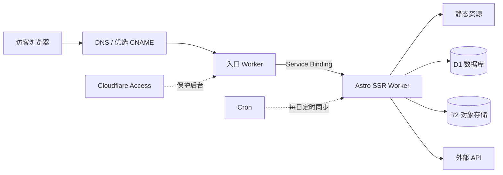
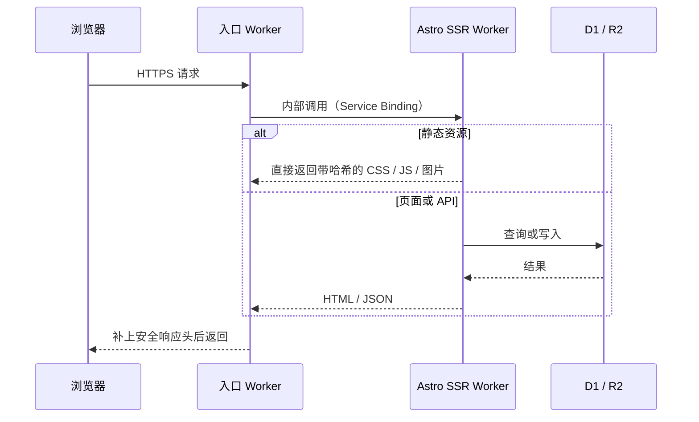

---
title: Building a Personal Website with Cloudflare
description: "Site architecture overview: two Workers, one SQL database, and one object storage service"
createdAt: 2026-08-13T00:00:00.000Z
updatedAt: 2026-08-13T00:00:00.000Z
published: true
tags:
  - Network
  - Build a Website
  - Optimization
slug: 20260813-02
---

## Quotation

My website runs on two Cloudflare Workers, an SQL database, and object storage. Comments, likes, and view counts update in real time; my book, movie, and music collections have their own admin dashboard, and my music rankings sync automatically every night at midnight. Apart from the domain, everything else on the bill costs virtually nothing.

This article describes its architecture.

## A Single Request's Path

## Database Design

D1 is Cloudflare’s managed SQLite database, used to store structured data such as comments, likes, view counts, and metadata for books, films, and music in your collection.

R2 stores all images: illustrations in articles and collection covers. The main reason I chose it is that egress traffic is free—bandwidth charges are the bane of image hosting. R2 stores only the files; the metadata for those files lives in D1, and the two are linked by object key.
## Image Pipeline

I write articles in Obsidian. The moment I paste an image, the image-hosting plugin uploads it directly to R2, leaving a URL in the Markdown. There are no image binary files anywhere in the repository, so the Git history never bloats.

At build time, the script generates multiple AVIF and WebP variants at several widths for each image the first time it appears (640 / 1280 / 1920), uploads them to the same directory in R2, and records the mapping in a manifest. When rendered, the URL in the Markdown remains unchanged, but the resulting HTML contains a complete `<picture>` element: the browser selects the smallest file sufficient for the viewport and pixel density, the first image in the article loads at high priority, and the rest are lazy-loaded. The original image URL always remains valid as a fallback.

## Little Money-Saving Tricks

>If your site is a purely static blog, Astro and static hosting are all you need—no Workers required.

If you need comments, an admin panel, or scheduled tasks, D1 plus an SSR Worker is a relatively low-cost option.

### Worker
Requests for static assets don’t execute any code or count toward Workers’ 100,000 free requests per day. CSS, JavaScript, fonts, and local images all fall into this category, so they’re free and unlimited. The only things that actually consume the daily allowance of 100,000 free requests are HTML rendering and API calls that require code to run.

So I keep as many requests as possible at the static layer. Only routes that require dynamic processing are configured to pass through a Worker first. This keeps request usage largely within the free-tier limits.

### D1
Keep an eye on D1 row reads. The free tier includes 5 million rows per day, but this counts rows scanned, not rows returned. A query that returns 20 comments could count tens of thousands of rows if it scans the entire table instead of using an index. Indexing commonly filtered fields and paginating lists can help you make the most of D1’s free tier.

###  A Note on Free-Tier Limits
The claim of zero cost here needs a qualification: excluding the domain name, the bill is approximately zero as long as traffic and data usage stay within the free tier. The specific allowances are (July 2026):

| Item           | Free allowance               |
| ------------ | ------------------ |
| Dynamic Worker requests | 100,000/day, shared across the account       |
| Static asset requests       | Free, unlimited             |
| D1           | 5 million row reads/day, 100,000 row writes/day |
| R2           | 10 GB of storage, free egress traffic    |

Note that 100,000 requests is the free daily limit for your entire account, not 100,000 per Worker.

Important: D1 charges based on rows scanned, so queries without indexes can make your bill skyrocket.

## Accelerating Access from Mainland China

Cloudflare’s default entry point uses Anycast, with routing determined by BGP, which isn’t always ideal for China’s three major telecom carriers. The same site may load quickly on China Telecom, while China Mobile users may experience detours and packet loss during the evening rush. My approach is to use an optimized CNAME: point my domain’s CNAME record to a hostname that continuously measures performance and updates its DNS responses.

Once traffic enters the site, speed depends on layered caching; the rules are based on how frequently each type of content changes:
- CSS/JS/fonts with content hashes: cache for one year
- HTML: `no-cache`, re-verify each time to ensure the latest code is being used
- Dynamic APIs such as comments and statistics: cache at the edge for 15 seconds; write requests always use `no-store`.
- The GitHub contribution graph is cached for 6 hours, while WakaTime data is cached for 15 minutes.

## In Brief

## References

- [Workers Platform Limits](https://developers.cloudflare.com/workers/platform/limits/)
- [Static Asset Billing Rules](https://developers.cloudflare.com/workers/static-assets/billing-and-limitations/)
- [Service Bindings](https://developers.cloudflare.com/workers/runtime-apis/bindings/service-bindings/)
- [D1 Pricing](https://developers.cloudflare.com/d1/platform/pricing/)
- [R2 Pricing](https://developers.cloudflare.com/r2/pricing/)
- [MDN: Cache-Control](https://developer.mozilla.org/docs/Web/HTTP/Reference/Headers/Cache-Control)