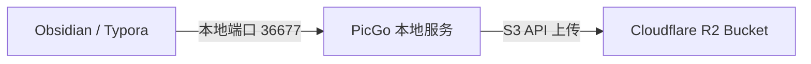

---
title: Build a Free Image Host with Cloudflare R2 + PicGo
description: Build an image host with no egress traffic fees based on Cloudflare R2 object storage and PicGo, enabling instant automatic uploads while writing in Obsidian and Typora.
tags:
  - cloudflare
  - freebie
  - image hosting
createdAt: 2026-10-25T00:00:00.000Z
published: true
slug: 20261025-01
---

## Architecture

Use Cloudflare R2 instead of traditional object storage as the backend for your image host.

1. Pasting an image in the editor triggers a local PicGo upload.
2. PicGo pushes the image to R2 through an S3-compatible API.
3. The API returns a Custom Domain link and automatically replaces the image address.

---
## Why Choose Cloudflare R2

Since it’s free, what more is there to say? The allowances are generous, and you basically won’t exceed them. It also completely eliminates egress traffic fees. For mainland China, the only drawback is that access is relatively slow without a VPN.

| Resource item                  | Cloudflare R2 free monthly allowance | Overage unit price          |
| :-------------------- | :------------------ | :-------------- |
| **Storage space**              | 10 GB / month           | $0.015 / GB / month |
| **Class A operations (writes/listing)** | 1 million operations / month          | $4.50 / million operations     |
| **Class B operations (reads/downloads)** | 10 million operations / month         | $0.36 / million operations     |
| Egress traffic                  | **Free forever, with no limit**        | **$0.00**       |

---
## Setting Up and Preparing Cloudflare R2

### Prerequisites
1. Log in to the Cloudflare Dashboard and open “R2 Object Storage”.
2. Link a credit card or PayPal to complete account verification. No charges will be incurred within the allowance.
> If you don’t have a card, try the second-hand marketplace—you can get one for under 10 RMB.

### Manual Web Configuration
1. **Create a Bucket**: On the R2 page, click “Create bucket”, enter a name, and set Location to Automatic.
2. **Bind a public Custom Domain**: Go to Bucket -> “Settings” -> “Public Access” -> click “Connect Domain”, then enter a subdomain (for example, `img.yourdomain.com`).
3. **Get API credentials**:
   - **Account ID**: On the bottom right of the R2 overview page, click “Account Details” and copy it directly.
   - **Access Key ID and Secret Access Key**:
	  1. Click “Manage API Tokens” below “Account Details” to open the token page.
	  2. Click “Create Account API token”.
	  3. Select “Object Read & Write” under Permissions, and specify a Bucket if needed.
	  4. Click to create it, then immediately copy and save the `Access Key ID` and `Secret Access Key` on the **final success page**.
  > **Note**: `Secret Access Key` is displayed only once, when it is successfully generated. If you did not save the key for a previously created Token, it cannot be viewed again. You must click “Create Account API token” again to generate a new key.

### Agent
Creating a Bucket and binding a Custom Domain can also be done by an agent through the Wrangler CLI. You only need to run Wrangler oauth to link your own Cloudflare account.

## PicGo Client Configuration

### 1. Install the Plugin
1. Open PicGo and go to “Plugin Settings”.
2. Search for and install `picgo-plugin-cloudflare-r2`.

### 2. Configure the Parameters
Go to “Image Hosting Settings” -> “Cloudflare R2” and fill in the following configuration items:

| **Account ID**      | View it at the bottom right of the R2 overview page      |
| :------------------ | :--------------- |
| **AccessKey ID**    | Generated API Token    |
| **SecretAccessKey** | Generated API Token    |
| **Bucket name**           | Created R2 Bucket    |
| **Storage path (optional)**        | Specify directory levels as needed         |
| **Custom domain**           | R2 Custom Domain |

---

## Automatic, Seamless Upload in Editors

### Obsidian Configuration
Use local PicGo to automatically upload pasted images to the image host and replace their paths:
1. Make sure PicGo is running.
2. In Obsidian’s “Third-party plugins”, search for and install `Image auto upload Plugin`.
3. Configure the plugin to use the PicGo upload service.
4. Paste or drag an image directly into Obsidian. It will be silently uploaded to R2 in the background, and the local path in the document will be automatically replaced with a remote image-hosting link.

### Typora Configuration
Typora natively supports using the PicGo client:
1. Open Typora and go to “Preferences” -> “Images”.
2. Select “Upload images” when inserting an image.
3. Check “Apply the above rules to images in local locations” and “Apply the above rules to images in network locations”.
4. Select `PicGo (app)` as the upload service, and specify the local PicGo executable in “PicGo path”.
5. Click “Verify image upload options”. The configuration is successful once all checks pass.

---

## Cache Optimization and Anti-Abuse Strategy

Although R2 egress traffic is free, Class B read requests exceeding 10 million per month will still incur a small charge. It is recommended that you enable CDN edge caching and protection.

In the Cloudflare Dashboard, go to your domain’s “Caching” -> “Cache Rules” and add a rule:
- **Match condition**: `Hostname equals img.yourdomain.com`
- **Edge Cache TTL**: Override the origin and set it to 1 year (31536000 seconds)
- **Browser Cache TTL**: Set it to 1 year

All high-traffic images will be cached by Cloudflare CDN nodes worldwide. Subsequent requests will no longer pass through to the R2 Bucket, minimizing Class B operation usage.