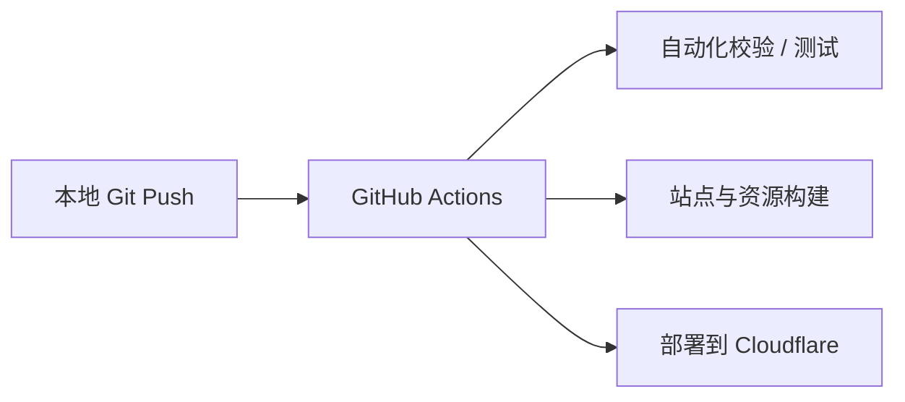

---
title: 使用 GitHub Actions 實現部落格自動更新
createdAt: 2026-08-13T00:00:00.000Z
published: true
updatedAt: 2026-08-13T00:00:00.000Z
description: 將部落格的檢查、建置與 Cloudflare 部署，全部交由 GitHub Actions 自動化流程處理。
tags:
  - 自動化
  - Actions
  - Cloudflare
slug: 20260813-01
---

## 自動化流程
所有驗證、資源處理與部署都在 GitHub Actions 中完成，並自動同步至 Cloudflare。


1. **本機推送**：透過 git 將 Markdown 內容推送到 GitHub 儲存庫。
2. **CI 觸發**：GitHub Actions 捕獲`push`事件並啟動建置容器。
3. **自動化處理**：依次執行內容檢查、靜態資源建置與 SSR 產物打包。
4. **CF 部署**：呼叫 Cloudflare Wrangler，直接更新線上服務。

## GitHub Actions 設定

在儲存庫根目錄下建立`.github/workflows/deploy.yml`：

```yaml
name: Deploy to Cloudflare

on:
  push:
    branches:
      - master
  workflow_dispatch:

jobs:
  deploy:
    runs-on: ubuntu-latest
    steps:
      - name: Checkout repository
        uses: actions/checkout@v4

      - name: Setup Node.js
        uses: actions/setup-node@v4
        with:
          node-version: 22
          cache: 'npm'

      - name: Install dependencies
        run: npm ci

      - name: Run checks
        run: npm test

      - name: Build and deploy
        run: npm run deploy
        env:
          CLOUDFLARE_API_TOKEN: ${{ secrets.CLOUDFLARE_API_TOKEN }}
          CLOUDFLARE_ACCOUNT_ID: ${{ secrets.CLOUDFLARE_ACCOUNT_ID }}
```

### 關鍵設定說明
在 GitHub 儲存庫設定中的`Secrets and variables -> Actions`新增`CLOUDFLARE_API_TOKEN`和`CLOUDFLARE_ACCOUNT_ID`。