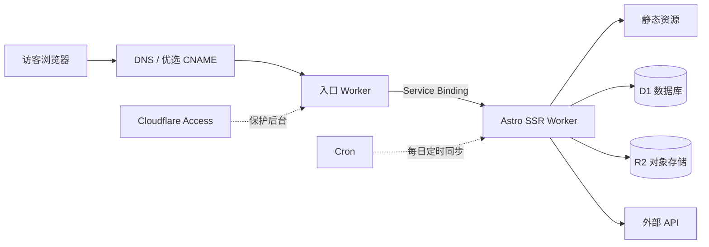
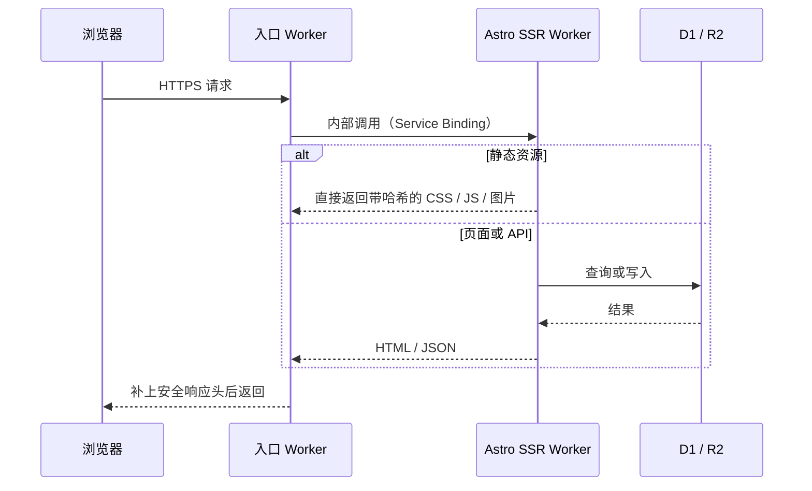

---
title: 基於 Cloudflare 建置個人網站
description: 此站架構介紹：兩個 Worker、一個 SQL 資料庫、一個物件儲存空間
createdAt: 2026-08-13T00:00:00.000Z
updatedAt: 2026-08-13T00:00:00.000Z
published: true
tags:
  - 網路
  - 建立網站
  - 優化
slug: 20260813-02
---

## 引文

我的這個網站運行著兩個 Cloudflare Worker、一個 SQL 資料庫和一個物件儲存服務。留言、按讚和瀏覽量都是即時的，書籍、電影與音樂收藏有自己的管理後台，聽歌排行每天凌晨自動同步。至於帳單，除了網域名稱之外，其他成本幾乎等於零。

本文介紹其架構

## 單一請求鏈路

## 資料庫設計

D1 是 Cloudflare 託管的 SQLite 資料庫，用來儲存結構化資料：留言、按讚、瀏覽量、書影音收藏的中繼資料等等。

R2 儲存所有圖片：內文插圖、收藏封面。選它的主要原因是出口流量免費，圖床最怕的就是流量費。R2 只儲存檔案，而與這些檔案對應的中繼資料在 D1 裡，兩邊透過物件鍵相互關聯。
## 圖片處理流程

我在 Obsidian 裡寫文章，貼上圖片的瞬間，圖床外掛就直接把它傳到 R2，Markdown 裡留下的是一個線上 URL。儲存庫裡從頭到尾都沒有圖片二進位檔案，git 歷史不會膨脹。

建置時，腳本會為每張首次出現的圖片產生 AVIF 和 WebP 的多個寬度版本（640 / 1280 / 1920），傳回 R2 的同一個目錄，並將對應關係寫入 manifest。渲染時，Markdown 裡的那個 URL 不變，輸出的 HTML 卻是完整的 `<picture>`：瀏覽器會依據視窗大小和像素密度，挑選最小且足夠的檔案，內文第一張圖片以高優先權載入，其餘圖片則延遲載入。原圖 URL 永遠有效，作為備援。

## 省錢小撇步

>如果你的網站是純靜態部落格，Astro 加上靜態資源託管就夠了，連一個 Worker 都不需要。
如果需要留言、後台和定時任務，D1 加上 SSR Worker 的成本比較低。

### Worker
命中靜態資源的請求不會執行程式碼，也不會計入 Workers 每天 10 萬次的免費請求額度。CSS、JS、字型、本機圖片都屬於這類，免費且不限量。真正會消耗每天 10 萬次免費額度的，只有需要執行程式碼的 HTML 渲染和 API 呼叫。

所以我讓盡可能多的請求停留在靜態層。只有必須動態處理的路徑，才設定為先經過 Worker。這樣請求用量基本上都在免費額度範圍內。

### D1
留意 D1 的行讀取量。D1 每天提供 500 萬行的免費額度，但計算的是掃描行數，而不是回傳行數。一個回傳 20 則留言的查詢，如果沒有使用索引而掃描整張表，計入的可能是幾萬行。為常用的篩選欄位建立索引，並對清單進行分頁，這些最佳化能最大限度地利用 D1 的免費額度。

###  注意免費額度限制
這裡所說的零成本需要加上限制條件：除網域費用外，只要流量和資料量都在免費額度內，帳單就約等於零。具體額度如下（2026 年 7 月）：

| 項目           | 免費額度               |
| ------------ | ------------------ |
| Workers 動態請求 | 10 萬次/天，帳戶共用       |
| 靜態資源請求       | 免費，不限量             |
| D1           | 500 萬行讀取/天，10 萬行寫入/天 |
| R2           | 10 GB 儲存空間，出口流量免費    |

注意，10 萬次是整個帳戶每天的免費上限，不是每個 Worker 各有 10 萬次。

特別注意：D1 依掃描的資料列數計費，未使用索引的查詢會讓帳單直接爆表。

## 加速中國大陸地區的存取速度

Cloudflare 的預設入口是 Anycast，路由由 BGP 決定，對中國境內三大電信業者不總是友善。同一個網站，電信可能很快，中國移動在晚間尖峰時段可能會繞路並丟包。我的做法是優選 CNAME：將網域名稱 CNAME 到一個會持續測速並更新解析結果的目標網域名稱。

進站後的速度靠快取分層，規則依內容的變動頻率決定：
- 含內容雜湊的 CSS／JS／字型：快取一年
- HTML：`no-cache`，每次都要重新驗證，確保使用的是最新的程式碼
- 留言、統計這類動態 API：邊緣快取 15 秒，寫入請求一律 `no-store`。
- GitHub 熱力圖快取 6 小時，WakaTime 快取 15 分鐘。

## 簡單說

## 參考

- [Workers 平台限制](https://developers.cloudflare.com/workers/platform/limits/)
- [靜態資源計費規則](https://developers.cloudflare.com/workers/static-assets/billing-and-limitations/)
- [Service Bindings](https://developers.cloudflare.com/workers/runtime-apis/bindings/service-bindings/)
- [D1 定價](https://developers.cloudflare.com/d1/platform/pricing/)
- [R2 定價](https://developers.cloudflare.com/r2/pricing/)
- [MDN：Cache-Control](https://developer.mozilla.org/docs/Web/HTTP/Reference/Headers/Cache-Control)